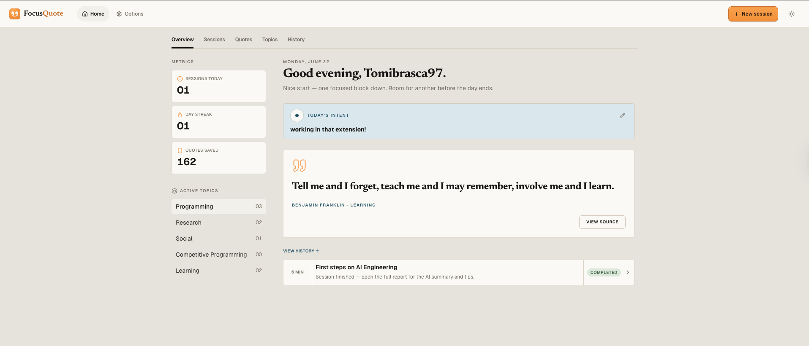
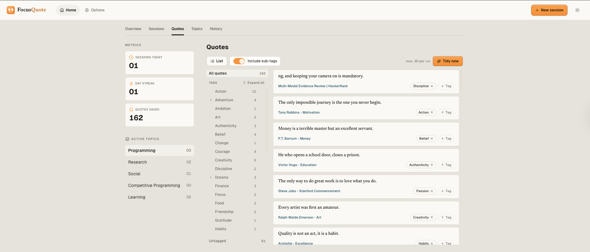
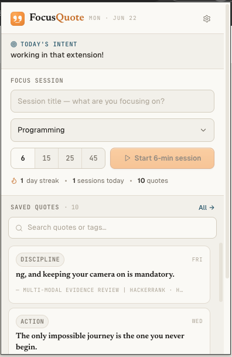
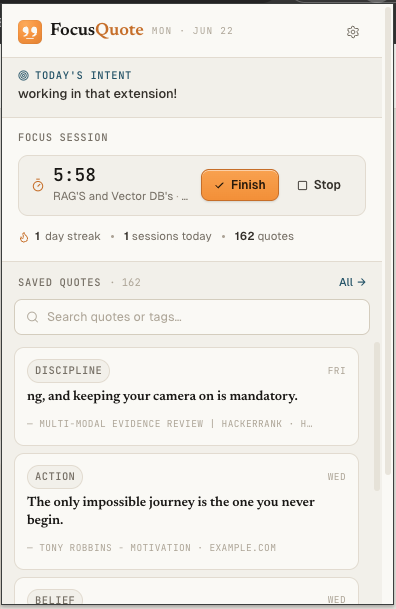
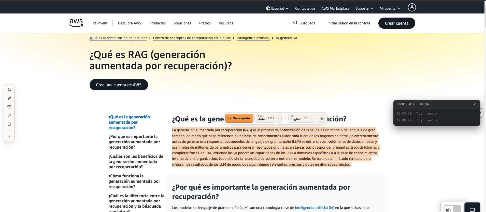
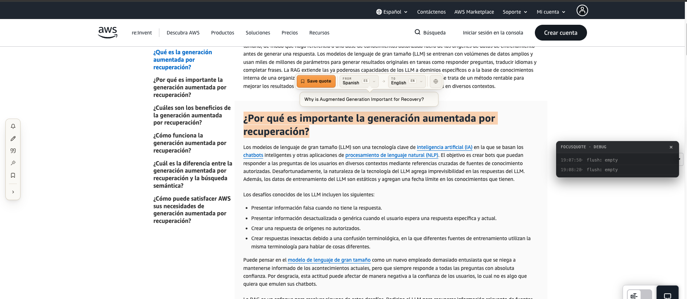
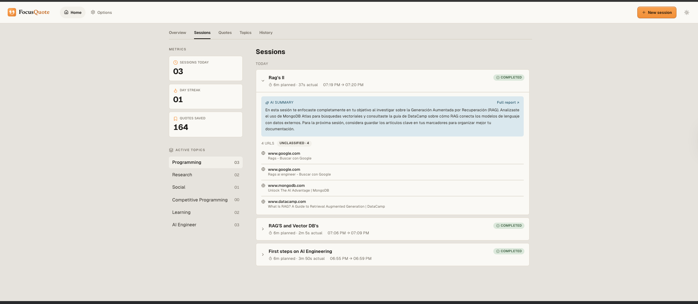
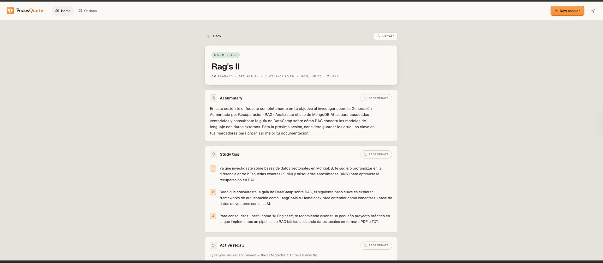
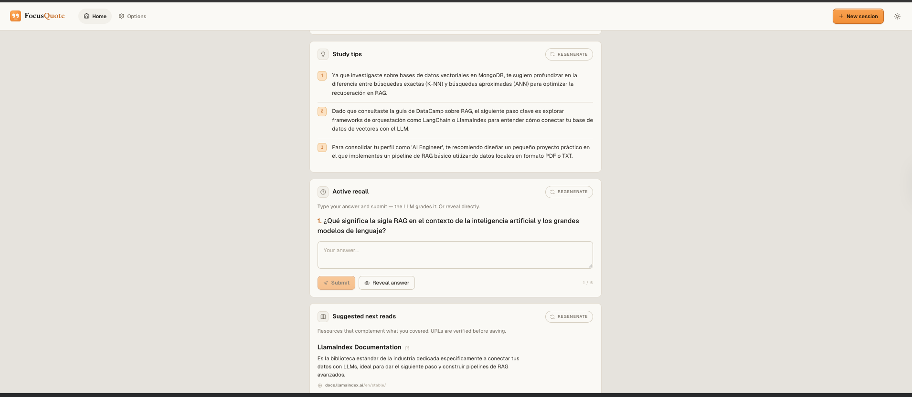
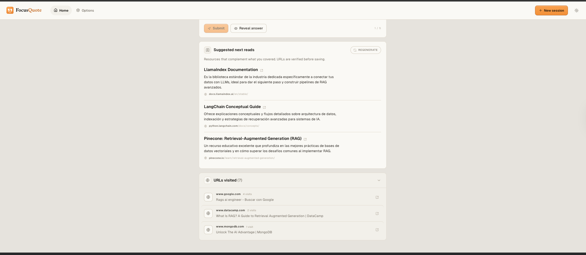

<div align="center">

# FocusQuote

**Capture what you read. Stay on what matters. Let AI tidy the rest.**

FocusQuote is a Chrome extension and backend for capturing quotes from the web,
running goal-oriented focus sessions, and getting AI-powered insight into how a
session actually went — which pages were on-goal and which were distractions.

[Features](#features) · [Showcase](#showcase) · [Quick start](#quick-start) · [Architecture](#architecture) · [Configuration](#configuration) · [Contributing](#contributing)


</div>

---

## What is FocusQuote?

FocusQuote turns aimless browsing into deliberate study. You open a **focus
session** with a goal, the extension quietly tracks the pages you visit, and when
you finish you get a report of where your attention went. Along the way you
**capture quotes** from any page — translating them on the spot if needed — and
the AI files them into a living **tag graph** you can tidy with one click.

It is built **offline-first**: every action is written to local storage
immediately and synced to the server in the background when you are online and
signed in. AI features are **opt-in** and run entirely server-side, so no API
keys ever live in the extension.

## Features

- **🎯 Focus sessions** — Start a timed session with a goal and a Topic. The
  extension records the pages you visit so the coach can tell on-goal work from
  distraction. The timer is incidental; the session is what gates capture.
- **✂️ Quote capture** — Save any passage from any page via the in-page toolbar
  or the context menu. Quotes are portable knowledge, filed globally in a tag
  graph — independent of any session.
- **🌍 Translate on save** — Capture a quote in one language and store it in
  another. The toolbar auto-detects the source and offers an AI-suggested title.
- **🏷️ Self-organizing tags** — The AI assigns and maintains tags as you save.
  Tags form a graph (a quote can carry several; a tag can have several parents).
  Anything you edit by hand is pinned and left alone.
- **🧹 One-click consolidation** — Hit **Tidy now** and the AI restructures the
  tag graph (merging duplicates, renaming, re-parenting) and re-files only the
  quotes those changes touch.
- **🧠 AI session report** *(opt-in)* — URLs visited during a session are
  classified by AI and distractions surface as nudges in real time over SSE.
  When you finish, you get a full report: a summary of what you covered,
  tailored **study tips**, an **active-recall** quiz that the LLM grades, and
  **suggested next reads** with verified URLs.
- **📊 New-tab dashboard** — A daily greeting, today's intent, your active
  Topics, streaks, session counts, and a quote of the day.
- **🔄 Offline-first sync** — Local writes are queued and drained to the server
  periodically, so the extension keeps working without a network.
- **🔐 Authentication** — Magic-link email or Google OAuth via Better Auth.

## Showcase

### New-tab dashboard
The home surface: today's intent, a quote of the day, active Topics, and your
streak and session metrics at a glance.



### Quotes library & tag graph
Every captured quote, filed into a navigable tag graph. Toggle **Include
sub-tags** to widen a filter, or hit **Tidy now** to let the AI consolidate.



### Focus session — start & run
Give the session a title and pick a Topic, choose a duration, and go. While it
runs, the popup counts down and the badge tracks the session.

<p align="center">
  
  &nbsp;
  
</p>

### Capture & translate inline
Select text on any page to bring up the capture toolbar. Save as-is, or translate
from the detected source language into your target — with an AI-suggested title.

<p align="center">
  
  &nbsp;
  
</p>

### Session history
Past sessions, each with its planned vs. actual time, an inline AI summary, and
the pages it tracked — grouped into classified and unclassified visits.



### Full AI session report
Open any session for the complete report: a summary of what you covered, tailored
study tips, an LLM-graded active-recall quiz, and suggested next reads with
verified URLs.

<p align="center">
  
  &nbsp;
  
</p>



## Architecture

A monorepo managed with npm workspaces:

```
apps/
  extension/   Chrome MV3 extension (Preact + Tailwind + Effect)
  server/      REST API (Hono + Drizzle + libSQL/Turso + Better Auth + Anthropic SDK)
packages/
  shared/      Effect Schema types + API contracts (imported by both)
```

- **Extension** — popup (timer + quotes), new-tab page (greeting + daily goal),
  options page, background service worker, and content script. State is managed
  through [Effect](https://effect.website) services layered over
  `chrome.storage.local`.
- **Server** — REST API under `/api/*`, authenticated with Better Auth bearer
  tokens. SQLite locally (`data.db`), Turso (libSQL) in production. AI calls run
  here, never in the extension.
- **Shared** — Effect `Schema` types and request/response contracts, so the wire
  format is identical on both sides. **Never duplicate a type** — import it from
  `@focus-quote/shared`.

### Repository layout

```
apps/extension/src/
  background/service-worker.ts   alarms, runtime messages, webNavigation, sync drain
  content/content.ts             "save quote" floating toolbar, text-selection capture
  popup/                         action popup (timer, quotes, sign-in)
  newtab/                        new-tab page (greeting, daily goal, stats)
  options/                       settings page (theme, API keys, privacy, blocklist)
  services/                      Effect services: api, sessions, quotes, sync, auth, urlTracker, realtimeStream
  shared/                        chrome.storage shapes, message types, prefs, privacy

apps/server/src/
  app.ts                         Hono app, CORS, route mounting
  auth.ts                        Better Auth (magic-link + Google + bearer)
  db/schema.ts                   Drizzle schema (users, sessions, quotes, focus_sessions, session_urls)
  lib/                           llm.ts (Anthropic), rate-limit.ts, session-bus.ts (SSE pub-sub), api-schemas.ts (zod)
  middleware/require-user.ts     bearer auth guard
  routes/                        quotes, focus-sessions, session-urls, stream (SSE), sync (batch)
```

## Quick start

### Prerequisites

- Node.js **20+**
- npm **10+**
- Google Chrome (or any Chromium browser that loads unpacked MV3 extensions)

### 1. Install & configure

```bash
git clone git@github.com:soundOfff/focus-quote.git
cd focus-quote
npm install

# Create the server env file and set a secret
cp apps/server/.env.example apps/server/.env
# open apps/server/.env and set BETTER_AUTH_SECRET — e.g.:
#   openssl rand -base64 32
```

### 2. Run both processes

```bash
# Terminal 1 — backend on http://localhost:3000 (auto-applies migrations on start)
npm run dev:server

# Terminal 2 — extension dev build with HMR
npm run dev:extension
```

### 3. Load the extension in Chrome

1. Open `chrome://extensions`
2. Enable **Developer mode**
3. Click **Load unpacked** and select `apps/extension/dist`
4. Copy the extension ID shown on the card, set it in `apps/server/.env` as
   `EXTENSION_ORIGIN=chrome-extension://<id>`, then **restart the server**

> ℹ️ The extension ID changes between fresh unpacked installs. If the extension
> can't reach the server, this mismatch is almost always why — see
> [Troubleshooting](#troubleshooting).

## Configuration

Set these in `apps/server/.env`. The authoritative list and validation rules live
in `apps/server/src/env.ts`.

| Variable | Required | Notes |
|---|:---:|---|
| `BETTER_AUTH_SECRET` | ✅ | `openssl rand -base64 32` |
| `BETTER_AUTH_URL` | ✅ | `http://localhost:3000` for dev |
| `EXTENSION_ORIGIN` | ✅ | `chrome-extension://<your-extension-id>` (from `chrome://extensions`) |
| `DATABASE_URL` | — | Defaults to `file:./data.db`; Turso `libsql://…` in prod |
| `DATABASE_AUTH_TOKEN` | — | Required when `DATABASE_URL` is a Turso URL |
| `GOOGLE_CLIENT_ID` / `GOOGLE_CLIENT_SECRET` | — | Enables Google sign-in |
| `RESEND_API_KEY` | — | Enables magic-link emails (otherwise links log to stdout) |
| `RESEND_FROM_EMAIL` | — | Verified sender address for Resend |
| `LLM_PROVIDER` | — | `anthropic` \| `openrouter`; auto-detected from the keys below if unset |
| `ANTHROPIC_API_KEY` | — | Enables AI URL classification + session summaries |
| `OPENROUTER_API_KEY` | — | OpenAI-compatible gateway as an alternative to Anthropic |
| `OPENROUTER_MODEL` | — | Defaults to `google/gemini-2.0-flash-001` |
| `SECRETS_ENCRYPTION_KEY` | dev: — / prod: ✅ | 32-byte base64; encrypts user-provided secrets at rest |

> The extension works fully without any LLM key — AI features simply stay dormant
> until one is configured.

## Common commands

```bash
# Health check
curl http://localhost:3000/health

# Typecheck the whole monorepo
npm run typecheck

# Run tests (workspace-aware, Vitest)
npm run test

# Production build of the extension → apps/extension/dist
npm run build:extension

# Drizzle: generate a migration after editing apps/server/src/db/schema.ts
cd apps/server && npm run db:generate

# Drizzle: apply pending migrations manually
cd apps/server && npm run db:migrate

# Re-record the portfolio demo loop (fake account, fixture AI, localhost only)
npm run demo:record -- --out <dir>
```

`demo:record` builds the extension against a demo API port, seeds a scratch database in `.demo/` as "Ada Lovelace", and runs the server with `DEMO_FIXTURES=1`. In that mode every AI call returns a canned reply from `apps/server/src/lib/demo-fixtures.ts`. The server refuses to start in demo mode if any provider key is set or if `DATABASE_URL` points at a `data.db`. The recorder fails if any request leaves localhost.

## Tech stack

| Layer | Technology |
|---|---|
| Extension UI | Preact · Tailwind CSS · lucide-preact · [Effect](https://effect.website) |
| Extension build | Vite · Chrome Manifest V3 |
| Server | [Hono](https://hono.dev) · Drizzle ORM · libSQL/Turso · [Better Auth](https://better-auth.com) |
| AI | Anthropic SDK (Haiku for classification, Sonnet for summaries) · OpenRouter (optional) |
| Shared contracts | Effect `Schema` (extension) ↔ Zod (server) |
| Language | TypeScript (strict, `noUncheckedIndexedAccess`) |

## Contributing

Contributions are welcome. A few conventions this repo holds to:

1. **Typecheck before committing** — `npm run typecheck` must pass with no errors.
2. **Conventional commits** — `feat:`, `fix:`, `refactor:`, `docs:`, `chore:`.
3. **Scope every user query by `userId`** on the server — no exceptions.
4. **Keep secrets server-side** — never put an LLM API key in extension code.
5. **Share types, don't duplicate them** — import from `@focus-quote/shared`.
6. **Commit schema + generated migration together** when changing the DB.

See [`CLAUDE.md`](CLAUDE.md) for the full engineering guidelines and
[`CONTEXT.md`](CONTEXT.md) for the domain glossary (the source of truth for what
terms like *Session*, *Topic*, *Vault*, *Quote*, and *Tag* mean).

## Deployment

Shipping the server (Turso + a Node host) and the extension (Chrome Web Store) is
documented in **[docs/DEPLOYMENT.md](docs/DEPLOYMENT.md)**, including the full
env-var reference, migration/backfill steps, and a release checklist.

## Troubleshooting

**"Backend did not return a bearer token" during sign-in** — Restart the server
after changing CORS settings, then request a fresh magic link (old ones are
single-use and expire after 5 minutes).

**Extension can't reach the server** — Confirm `EXTENSION_ORIGIN` in
`apps/server/.env` matches your extension ID exactly (visible in
`chrome://extensions`), then restart the server.

**Capture toolbar or fonts missing on a page** — The extension was reloaded but
the tab wasn't refreshed, orphaning the content script. Reload the page.

**Migrations need to re-run** — `cd apps/server && npm run db:migrate`. They also
run automatically on `npm run dev:server`.

**Start over from scratch:**

```bash
# Stop both terminals with Ctrl+C, then:
npm run dev:server     # terminal 1
npm run dev:extension  # terminal 2
```

## License

[MIT](LICENSE)
</content>
